<h1 align="center">Hi 👋, I'm Nidhi Bhide</h1>

<h3 align="center">
  🚀 Full Stack Developer | MERN Stack | Next.js | Open to New Opportunities
</h3>

  

  

### 🌟 About Me

- 💻 Full Stack Developer with **2.4 years of experience** building web applications.
- 🚀 Experienced in developing frontend interfaces, backend APIs, and full-stack applications.
- 🛠️ Skilled in **MERN Stack, Next.js, TypeScript, and REST APIs**.
- 💡 Interested in building scalable, user-friendly applications and solving backend challenges.
- 📬 Reach me at **nidhibhide144@gmail.com**

### 🌐 Connect With Me

  

### 🛠️ Tech Stack

#### 👩‍💻 Languages

#### 🌐 Frontend

#### 🧩 Backend

#### 🛢️ Databases

#### ⚙️ Tools

### 🚀 Featured Projects

- **LearnCode** – Full-stack coding assessment platform built using MERN Stack. [View Project](https://learn-code-three.vercel.app/)
- **Budget Buddy** – Personal finance management application built using Next.js. [View Project](https://budget-buddy-next-js.vercel.app/)

### 📈 GitHub Stats

  

  

